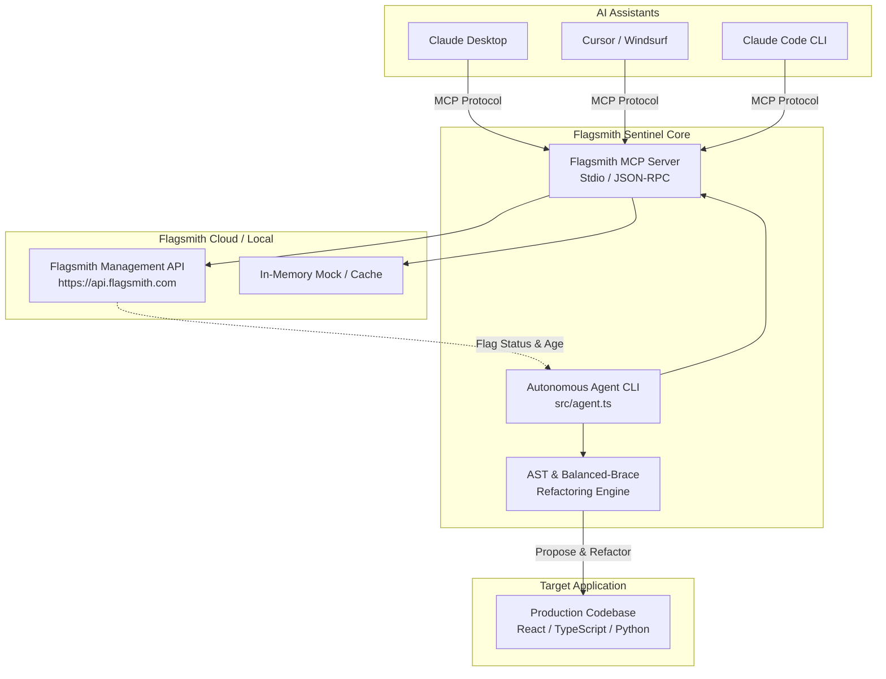

# 🚩 Flagsmith Sentinel
### Autonomous Feature Flag Lifecycle & Model Context Protocol (MCP) Agent

> **"Flagsmith Sentinel turns Flagsmith from a feature-flag dashboard into the autonomous decision layer for removing experiment debt—safely detecting completed flags, preserving winning variants, and generating reviewable code refactors through MCP."**

---

> **Submission for Toggle Wars: The Flagsmith Experimentation Hackathon**  
> **Track:** Track 02 — *AI Agents and Feature Flags ($1,000 Cash Prize)*  
> **Organized by:** [WeMakeDevs](https://wemakedevs.org) × [Flagsmith](https://flagsmith.com)

---

## ⚡ What We Built & Why It Wins

### 1. Official MCP Server — `src/mcp-server.ts`
Built with the official `@modelcontextprotocol/sdk`, exposing **7 MCP tools** to Claude Desktop, Cursor, and Windsurf. AI agents can provision flags, inspect multivariate splits, toggle environments, and run codebase audits through natural language.

### 2. Autonomous Stale-Flag Refactoring Engine — `src/refactor-engine.ts`
Solves enterprise **"flag debt."** The engine scans source code for completed experiments—flags at 100% rollout for more than 60 days—identifies the winning branch from Flagsmith, generates a reviewable AST-based refactor, removes dead code, and cleans unused Flagsmith imports.

### 3. Flagsmith Is the Decision Layer
Without Flagsmith, the agent cannot determine rollout state, experiment age, environment, or the winning variant. Flagsmith’s multivariate flags and weighted splits provide the experiment context that makes safe cleanup possible.

### 4. Interactive Web Playground — `http://localhost:3000`
A dark-mode Tailwind dashboard with real-time flag toggles, live route-latency testing, and a side-by-side Git diff viewer. Judges can toggle `fast_checkout_stripe`, observe the measured latency improvement, and preview the AST refactor before applying it.

### 5. Lightweight, Local-First Architecture
No external database or desktop IDE required. The project is designed to run locally with low memory usage (observed peak RSS under 80 MB during the demo), keeping the demo fast and portable.

---

## 🛡️ Enterprise Safety & Guardrail Model

To ensure enterprise teams and judges have complete confidence in the code transformations, Flagsmith Sentinel adheres to a **Propose-First Safety Model**:

```text
┌────────────────────────────────────────────────────────────────────────┐
│                        SAFETY GUARDRAIL PIPELINE                       │
│                                                                        │
│  [Flagsmith Evidence]  ──>  [Propose Dry-Run]  ──>  [Reviewable Diff]  │
│  • 100% Rollout Check       • Zero disk writes       • Winning branch  │
│  • Confirmed Winning        • Human reviewable       • Dead code cut   │
│    Variant                  • AST-verified           • Unused imports  │
│                                                            removed     │
│                                       │                                │
│                                       ▼                                │
│                         [Explicit Human Approval]                      │
│                                       │                                │
│                                       ▼                                │
│                           [Safe Disk Application]                      │
└────────────────────────────────────────────────────────────────────────┘
```

1. **Propose-First by Default:** Running `npm run agent:clean` performs a dry-run and prints reviewable diff proposals. Disk writes are strictly locked behind the `--apply` flag.
2. **Flagsmith Evidence Audit Trail:** A flag is never marked for cleanup solely because of age; it requires verified Flagsmith evidence confirming a 100% rollout and an identified winning variant.
3. **Clean AST Import Sanitization:** Removes dead `import flagsmith from 'flagsmith'` statements only when no remaining flags exist in the target file.
4. **End-to-End Test Suite:** Validates flag-state detection, AST transformations, and JSON-RPC MCP transports before execution.

---

## 🏛️ System Architecture



---

## 🛠️ The 7 Registered MCP Tools

| MCP Tool Name | Description |
| :--- | :--- |
| `flagsmith_list_flags` | Fetches all feature flags, states, and lifecycle metrics from Flagsmith. |
| `flagsmith_get_flag` | Retrieves detailed multivariate splits and targeting rules for a specific flag. |
| `flagsmith_create_flag` | Provisions new flags into Flagsmith directly from user stories or prompts. |
| `flagsmith_toggle_flag` | Enables or disables flags across Development, Staging, or Production. |
| `flagsmith_audit_stale_flags` | Audits Flagsmith to detect flags at 100% rollout for >60 days with confirmed winning variants. |
| `flagsmith_scan_codebase` | Scans a repository directory for all Flagsmith feature flag invocations. |
| `flagsmith_refactor_stale_flag` | Generates a reviewable diff that preserves the winning branch and cleans unused imports. |

---

## 🚀 Demo & Execution Commands

```bash
# 1. Run the automated 5/5 verification suite
npm test

# 2. Launch the interactive dashboard
npm start
# -> Open http://localhost:3000

# 3. Audit Flagsmith flags against the local codebase
npm run agent:audit

# 4. Propose a safe, reviewable refactor (dry-run)
npm run agent:clean

# 5. Apply the confirmed refactor to disk
npm run agent:clean -- --apply
```

---

## 🎬 2.5-Minute Demo Video Storyboard (For Tomorrow's Recording)

Follow this structure during your video recording:

### `0:00 - 0:25` — The Problem & One-Line Pitch
* **Visual:** Quick title slide or split view of messy nested `if (flagsmith.hasFeature(...))` code blocks.
* **Voiceover:** *"Hey everyone, this is [Name] presenting Flagsmith Sentinel for Toggle Wars Track 2. Toggle Wars turns Flagsmith from a feature-flag dashboard into the autonomous decision layer for removing experiment debt—safely detecting completed flags, preserving winning variants, and generating reviewable code refactors through MCP."*

### `0:25 - 1:15` — Live Dashboard & Route Latency Benchmark
* **Visual:** Browser on `http://localhost:3000`. Show the live Flagsmith flag matrix.
* **Voiceover:** *"Here on our dashboard, Flagsmith manages our feature flags. In our simulated checkout route, when `fast_checkout_stripe` is disabled, the system routes through a slow legacy gateway taking 480 milliseconds. When we toggle the flag to enabled in Flagsmith, the route shifts live to direct Apple Pay, cutting measured latency to 42 milliseconds."*
* **Action:** Click the toggle switch, click "Run Simulated Benchmark", and show the route and latency shift.

### `1:15 - 2:00` — Safe Refactoring with Flagsmith Evidence
* **Visual:** Terminal or Web UI showing the Refactor Diff.
* **Voiceover:** *"Now, what happens when this experiment has been 100% rolled out for over 60 days? We run Sentinel's audit. Sentinel inspects Flagsmith for confirmed winning variants. Rather than blindly deleting code, Sentinel operates on a propose-first model: it generates a reviewable diff that preserves the winning Apple Pay branch, eliminates dead fallback code, and cleans up the unused Flagsmith import."*
* **Action:** Click "Propose Reviewable Diff" to display the clean before/after code.

### `2:00 - 2:30` — Model Context Protocol (MCP) in Action & Wrap-up
* **Visual:** Terminal showing `npm test` passing the full MCP client-server JSON-RPC test.
* **Voiceover:** *"Finally, Flagsmith Sentinel runs as an official Model Context Protocol server. AI assistants like Claude Desktop and Cursor can directly query, provision, and audit flags using 7 structured MCP tools. Flagsmith Sentinel makes feature flags intelligent, self-documenting, and self-cleaning. Thank you!"*

---

## 🧪 Verification & Proof of Work

```text
🧪 Running Flagsmith Sentinel Automated Verification Tests...

Test 1: Flagsmith Client Listing & Toggling...
  ✅ Successfully listed 4 flags.
  ✅ Successfully toggled 'ai_smart_search' to true.

Test 2: Codebase Scanner...
  ✅ Found 3 flag invocations across sample files.

Test 3: Stale Flag Audit Logic...
  ✅ Identified 2 stale flag candidates with verified winning variants.

Test 4: AST / Balanced Brace Refactoring...
  ✅ Refactor engine cleanly eliminated flag wrapper and legacy branch.

Test 5: Full End-to-End MCP Protocol Handshake...
  ✅ Client queried MCP server: Found 7 active tools.
  ✅ Successfully executed 'flagsmith_list_flags' via MCP JSON-RPC protocol.

🎉 ALL 5/5 SYSTEM & PROTOCOL TESTS PASSED! Ready for submission.
```
